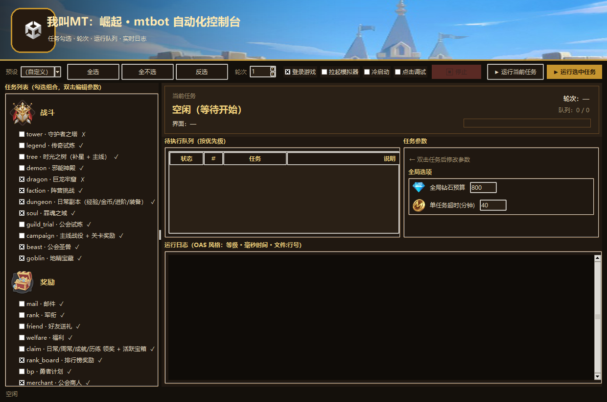

# mtbot —— 《我叫MT：崛起》自动化（OAS 风格分层版）

从 2026-10-27~29 三天真机实操里把《我叫MT：崛起》的界面（像素探针版）沉淀成了一个分层的
自动化工程。设计参考 OnmyojiAutoScript：**配置驱动 + 页面状态机 + 任务模块 + 调度器**，
不再有“一个大脚本从头点到尾”的写法。

```
mtbot/
  device.py      设备层：adb（截图/点击/按键/前后台），不认识游戏
  emulator.py    模拟器层：MuMuManager 启动、状态查询
  vision.py      视觉层：像素判读 + 画面状态分类（State 枚举），不认识 adb
  ocr.py         数字识别：模板匹配读英雄等级/资源数字
  template.py    图标模板匹配（cv2）：层名/资源图标/按钮这类像素阈值不好判的东西
  titles.py      页面标题识别：每个玩法页顶部标题条做锚点（塔/传奇/树/神殿/巨龙/阵营/地精/公会/日常）
  templates/     模板素材（720×1280 1:1，部分来自 E:/DailyIdea 的 assets）
  layout.py      坐标表：所有实测坐标集中在这里
  ui.py          UI 层：回主城/关弹窗/断线重连/登录流程
  pages.py       页面对象：MianCity / TrialsHub / Tower / Tree / Demon / Daily / Guild ...
  tasks/         业务任务（按 战斗/奖励/提升 三类）：combat / dungeon / soul / events /
                 goblin / daily / reward / rankboard / merchant / assist（助阵四个子系统 + 助战徽记）
  scheduler.py   调度器：按配置挑任务、按优先级执行、逐任务隔离错误、记录状态
  run.py         CLI
  gui.py         图形界面（Tkinter，任务勾选 + 轮次 + 队列/当前任务 + 参数 + 实时日志）
  gui_assets/    界面美化素材（横幅/图标，来自解包资源，生成脚本 tools/make_gui_assets.py）
mt.py            入口包装（python -I mt.py ...）
tests/           视觉与日志回归测试（真机截图 fixtures）
config.json      设备/模拟器/限流/任务参数
```

## 快速开始

```bash
python -I E:\Reverse\auto_script\mt.py --gui                # 图形界面（推荐）
```
```bash
python -I E:\Reverse\auto_script\mt.py --list                 # 看任务清单和预设
python -I E:\Reverse\auto_script\mt.py --dry-run --profile full  # 只看计划
python -I E:\Reverse\auto_script\mt.py --profile daily        # 每日任务
python -I E:\Reverse\auto_script\mt.py --profile upgrade      # 提升
python -I E:\Reverse\auto_script\mt.py --profile combat       # 塔/传奇/树/神殿/巨龙/阵营/日常副本/罪魂之域/地精
python -I E:\Reverse\auto_script\mt.py --profile reward       # 奖励
python -I E:\Reverse\auto_script\mt.py --profile full --boot  # 全套：开游戏→登录→做完
python -I E:\Reverse\auto_script\mt.py --task tower --boot --emulator  # 单任务
python -I E:\Reverse\auto_script\mt.py --status               # 上次运行状态
```

`--boot` 会调用登录流程（公告 → 标题页 → 离线收益/活动弹窗 → 主城），`--emulator` 额外拉起模拟器。

## 图形界面（--gui）

`mt.py --gui` 打开控制台（预览见 `docs/gui_preview.png`）：




- **界面素材来自解包资源**（`E:/Reverse/export`）：顶部横幅是 `hero_details_back_3` 的城堡段，
  应用图标/分类图标（战斗/奖励/提升）用 `ic_launcher_foreground`、`icon_zc_kfkh`、
  `icon_xsfl_ysz`、`icon_zc_kfgh`，金币/钻石图标用 `currency` 包。
  生成脚本 `tools/make_gui_assets.py`，产物在 `mtbot/gui_assets/`（换素材重跑即可）。
- **列表**：按「战斗 / 奖励 / 提升」三组列出 36 个任务（带分类图标），勾选即可自由组合；
  「预设」下拉可一键套用 reward / daily / combat / full；支持全选、全不选、反选。
- **轮次**：工具栏「轮次」填 N（1~99），整套任务会重复跑 N 轮（CLI 等价于 `--rounds N`）；
  日志里每轮打印 `===== 第 r/N 轮 =====` 和“本轮结束”汇总，被 OAS 占用等中止时不再进下一轮。
- **状态卡**：大字显示**当前任务**（随日志 `Current task:` 实时更新，窗口标题也会跟着变）、
  当前界面、`第 r/N 轮`、队列进度条（完成数/总数）。
- **待执行队列**：按优先级列出本轮任务，状态实时切换 等待/进行中/完成/失败/未执行/中断；
  进程被停止或中止时，没跑完的行会自动收尾成“中断/未执行”，不会一直挂着“进行中”。
- **任务参数**：双击任务名后按 `PARAM_SPECS` 自动生成表单，改完写回 `config.json`；
  全局钻石预算、单任务超时在同一栏里（带金币/钻石图标）。
- **日志区**：实时显示子进程输出（OAS 格式，见下），按等级着色，ERROR 为红色。
- 「▶ 运行选中任务」「▶ 运行当前任务」在独立子进程执行，可随时「⏹ 停止」。

## 日志（OAS 风格）

```
INFO     2026-10-29 12:26:29.754 │ [Task] tower (Enable, 10, 2026-10-29 12:26:29)
INFO     2026-10-29 12:26:29.754 │ Current task: tower
INFO     2026-10-29 12:26:29.755 │ module_path: E:/Reverse/auto_script/mtbot/tasks/combat.py, module_name: TowerTask
INFO     2026-10-29 12:26:33.101 │ <<< UI GOTO PAGE_MAIN >>>
INFO     2026-10-29 12:26:35.402 │ [UI] main_city
INFO     2026-10-29 12:26:38.716 │ [3.3s] Page arrived page_main
INFO     2026-10-29 12:26:41.020 │ [UI] trials_hub
INFO     2026-10-29 12:26:44.977 │ [mtbot/tasks/combat.py:38]   塔胜利 1
ERROR    2026-10-29 12:27:02.331 │ [mtbot/tasks/combat.py:71]   塔异常: ...
ERROR    2026-10-29 12:27:02.331 │ [mtbot/scheduler.py:82] Traceback (most recent call last):
         ... 文件:行号 堆栈 ...
```

- 每行固定 `等级 + 毫秒时间戳 + │ + 来源文件:行号 + 内容`，出问题能直接定位到代码位置。
- `[UI] page_xxx` 每次界面状态变化才打印一次（主城/历练/布阵/战斗/结算/失败/断线…）；
  `<<< UI GOTO PAGE_MAIN >>>` 与 `[x.xs] Page arrived ...` 是导航开始与到达耗时。
- `[Task]`、`Current task`、`module_path` 与 OAS 一致，可用来对照任务脚本文件。
- 任务异常会打印 traceback，并把当时的画面存到 `logs/screens/error_<任务>_*.png`。

## 核心设计

### 1. 状态（而不是“死坐标连按”）

`vision.classify()` 把截图归类为这些状态：

| 状态 | 判据 |
|---|---|
| MAIN_CITY | 顶部天空像素 B>210、140<G<200、R<125 |
| MAIN_CITY_DIM | 主城被弹窗压暗（底部导航亮度骤降） |
| TITLE | 标题页「开始游戏」金色按钮 |
| TRIALS_HUB | 历练页紫蓝色星光背景 |
| DEPLOY | 布阵页「一键上阵」青绿按钮 |
| BATTLE | 底部 5 张英雄卡那一排亮 + 场地中部偏暗（排除促销页误判） |
| DIALOG | 米色弹窗（公告/奖励/提示）：点空白关闭 |
| RESULT_TOWER / TREE / GENERIC / LEGEND | 结算页：先看「胜利」暖金横幅（560,300，R−B>80），再按主按钮位置区分 |
| RESULT_DEFEAT | 结算页但横幅是淡紫色 / 按钮不亮 |
| QUIT_DIALOG / RECONNECT / RECONNECT_LOGIN | 三种弹窗 |

所有任务都是「看状态 → 做一个动作」的循环，所以**可以从任意界面、任意进度开始或重复运行**：
塔已经打过、奖励已经领过、商店已经刷新过，任务会自然跳过。

### 2. 页面对象封装导航

`pages.py` 里每个页面知道“怎么进、有什么按钮”：`TrialsHub.enter("tree")` 会先滚回列表顶部再
滚一屏到时光之树；`FightMixin.deploy_and_skip()` 负责布阵→战斗→**战斗内跳过 (655,900, 300ms)**，
一战 60–90 秒压缩到 1 秒。

### 3. 任务、限流与配置

- 任务参数（打几场、连败几次、钻石预算）在 `config.json` 的 `tasks.<名字>.params`。
- `limits.diamond_budget` 是全局钻石上限，快速挂机/公会试炼买次数会计入。
- `runtime.max_task_minutes` 兜底防死循环。
- 运行状态写 `logs/state.json`，`--status` 查看每个任务上次的结果。
- 日志按天写 `logs/mtbot_YYYYMMDD.log`，截图在 `logs/screens/`（自动只留最近 300 张）。

### 4. 错误隔离

调度器对每个任务做 try/except：一个任务崩了记录堆栈、存一张画面，然后回主城继续下一个。
任务之间强制 `ensure_main_city()`，避免上一步留在奇怪界面影响下一步。

## 任务清单

2026-10-30 起按用户要求只保留**三个分类**：战斗 / 奖励 / 提升。竞技相关（角斗场、
荣耀竞技场、争霸赛）已整体删除。

| 分类 | 任务 | 说明 |
|---|---|---|
| 战斗 combat | tower / legend / tree / demon / dragon / faction / dungeon / soul / goblin / guild_trial / beast / campaign | 守护者之塔（**先爬完再领进度奖励/每日奖励**）、传奇试炼、时光之树（**补星 → 主线，打完领每日奖励**）、邪能神殿、巨龙牢窟、阵营挑战（一层 30 波、无跳过键、增益选最左）、**日常副本**（经验/金币/进阶/装备四个副本：先推进，打不过再免费扫荡，领通关宝箱）、**罪魂之域**（新副本，水晶节点快速战斗）、地精宝藏（**先统计前十层再占领**）、公会试炼、公会圣兽、主线 |
| 奖励 reward | mail / rank / friend / welfare / claim / rank_board / bp / bounty / merchant / idle / shop / donate | 邮件、**官阶**（军衔页：领取后整行会移到末尾、整列上浮，按金色按钮动态找、一直滚到底）、好友、福利（**页签条可滑动，英雄集结/双倍签到/周末补给/终身福利都领**）、日常/周常/成就/历练领取、**排行榜奖励**（先认页签上方的红「!」再切榜单；进度奖励是竖排列表，点带红「!」的奖励图标领取）、**悬赏**（只接史诗/传说/神话，刷新自动接取，积分不够不刷新）、**公会商人**（议价 >1100 才买）、快速挂机+收益、商店免费刷新、公会捐献 |
| 提升 upgrade | relic / star / equipment / glory_book / inherit / artifact / pet / assist_mark / collection / hero_bond / hero_level / forge | 圣物、升星、装备强化/升星、**荣耀之书**（优先战士，被等级要求卡住再补其它职业）、**天神传承**、**神器**（按「等级」均衡升最低那件；橙色按钮是「进阶」，面板那行是「品阶 +N」不是等级）、**战宠**、**助战徽记**（英雄页右上「助战」：材料够就一直升级）、**图鉴升级**（英雄/专武/神器三个分类，书图标→图鉴等级面板→金色升级）、**英雄羁绊**（英雄/专武/神器三个分类，只点带红「!」的升级）、英雄升级/进阶、装备强化单次 |

助阵的四个子系统（荣耀之书 / 天神传承 / 神器 / 战宠）2026-10-31 按用户要求**拆成独立任务**，
可以单独勾选调试；「助战徽记」是英雄页里另一个系统，单独一个任务 `assist_mark`。

预设：`combat` / `reward` / `upgrade` / `full` / `all`（旧的 `daily` 保留为混合预设）。

## 真机经验（写进代码的坑）

- 本作 **50ms 的 input tap 经常不响应**，所有点击默认 220ms 长按；树页「挑战」要 350ms。
- 战斗内右侧第四个按钮 (655,900) = **立即结算**；布阵页按钮实际在 y=1230（视觉 1160）。
- 结算按钮命中点：塔「下一关」(465,1075)、树「下一关」(495,1130)、末关「确定」(370,1130)、
  失败页「再次挑战」(465,1090)。
- 日常页任意「领取」会一次领完全部；四个活跃度宝箱在 (270/380/490/600, 258)。
- 经验副本「一键扫荡」弹窗里钻石扫荡默认勾选，点一次扣 400 钻——脚本只认单个副本的免费扫荡。
- 挂机特权弹窗没有 X，用底部「战役」tab 退出；「挂机收益」弹窗点 (360,1228) 关。
- 断线有两种弹窗：「继续重连」(465,748) 和只有「确定」(360,748)→需重新登录。
- **全屏促销页（累充/超值首充/公会圣兽）没有遮罩**，点空白无效、状态也不是“被压暗”：
  `ui.close_promo()` 会在右上角找红色圆形 X（命中点偏移 -20,+10），找不到就按左下返回箭头
  （不再盲猜点位，避免在活动页上误点购买按钮）；登录流程和回主城流程遇到 `unknown` 都会调用它，
  冷启动实测 32 秒进主城。
- 公告页是米色弹窗（新状态 `DIALOG`），曾被误判成 battle/结算导致登录卡死，现已单列状态并点空白关闭。
- **圣物页**：升级页的「升级」大按钮无论材料够不够都是金色，必须用「一键升级」右上角红点判断；
  升星页有金色「升星」就点；羁绊页每行「升级」是**饱和橙金**（实测填充 222,180,99，R−B≈123），
  行高约 183 但会随滚动整体上下移动，固定 y 实测偏上约 40px（2026-10-29），所以改成
  `RelicTask._bond_buttons()` 按颜色聚类动态找按钮中心，固定行 (348/532/715/898) 仅作兜底；
  条件不足（如「全部达到神话4星 0/2」）时点了没反应，日志会写明“无确认框”。
  材料不足会弹紫色「获取途径」说明窗，脚本识别后关掉、不计成功。**回主城走左下返回键**，
  不是点空白（旧日志里连点 (200,700) 就是误判成失败结算导致的）。
- **英雄升级/进阶的真实机制（2026-10-30 实测）**：英雄详情「升级」页的大按钮**视觉中心
  (360,1060) 点不动，真实命中点在 (470,1060)**（和布阵页一样，视觉和热区错位）；按钮有两个阶段：
  ①「进阶」= 突破品阶（消耗进阶石，例如 750 级要 3300、800 级要 3500），点完弹「属性加成」预览框，
  要点框里的 (360,917) 才生效，然后点空白关掉「进阶成功」浮层；②进阶成功后按钮变成「升50级」，
  按一次直接 +50 级（消耗金币/英雄经验）。进阶石不够时按钮是禁用的，按了没有任何反应。
  另外英雄详情面板会整体上移约 17px（等级数字从 y≈860 到 y≈843），旧 OCR 框会切掉数字顶部，
  现在用 (95,828,265,879) 的宽框覆盖两种布局。修完后 _advance 会交替执行进阶/升50级，
  读数正确（今天因进阶石只剩 1189 < 3300，正确停在“按钮没反应”）。
- **爬塔奖励（2026-10-30）**：塔页左上「进度奖励」宝箱（红点/数字）里有按层数解锁的里程碑，
  每行一个金色「领取」，领完列表上移、还能往下滚；右下「每日奖励」按昨日层数发金币（今天已领时
  是绿色「已领取」）。TowerTask 进塔后先领这两处再开打，日志会打「塔进度奖励领取 ×N」。
- **福利页改版（2026-10-30）**：原来的 4 个固定页签 + 一个「终身福利领取」坐标已经全过期。
  现在是活动合集：底部是可横向滚动的页签条（集结/限时累充/上古宝库/双倍签到/连续充值/终身福利/
  萌新指南），大部分是充值页。脚本只碰免费内容，充值页（限时累充/特惠礼包/连续充值）绝不点购买。
  **页签条其实是能滑的**（2026-10-31 修正：早先“点最左/最右页签拨窗口”的做法会看不全），
  现在手指右滑把窗口拨回最左端、按槽位逐个点，靠标题模板（英雄集结/每日签到/周末补给/
  终身福利）确认当前页——详见 2026-10-31 那条。
- **主城顶部的限时活动图标会随活动轮换换位置**（达标返利、千抽福利、勇者计划等），
  按固定坐标点会点错：`rebate`（达标返利）与争霸赛都已按需求删除；
  其余顶部图标任务在进入后若发现还停在主城会直接跳过并警告，不会乱点。
- **装备强化/升星（equipment）**：进铁匠铺时如果装备可升星，游戏会自动弹「一键升星」批量窗；
  没弹的话按固定流程走：强化页点「一键50级」（每点一次强化一件，价格会涨）→ 升星页点右下
  「一键升星」（(612,1077)，点开是批量弹窗，按钮灰=没有符合条件的装备）→ 回强化页再点，
  循环到「一键50级」上方价格变红（金币不足）且升星弹窗显示没有可升的为止。
  判据：**价格文字颜色**（金币够是绿色约 202 个绿像素、不够是红色约 223 个红像素，
  不能用 is_gold——大按钮无论够不够都是金色）；升星弹窗靠右上红 X + 中央按钮金色/灰米色区分。
  强化页四件装备的「强化1次」按钮本身是土黄色不亮，只能看右上角红点判断可点。
- **助阵（2026-10-31 拆成 glory_book / inherit / artifact / pet 四个任务）**：主城底部第三个页签进圆环菜单，四个子系统都做自动升级——
  荣耀之书（4 个职业页签 × 底部「升级」）、天神传承（4 套传承 ×「突破」）、
  神器（「升级」直接吃材料升等级、「升星」）、战宠（圣坛「升阶」、培养「升星」）。
  判据：按钮右上角**红点** = 材料够；橙色突破/升阶按钮本身不是红点（角标 B<65、按钮 B≈80）；
  战宠按下大按钮会先弹**预览窗**（右上角红 X、真正的按钮在窗内），要进窗里再点；
  点完用面板中部文字区**前后像素差**验证是否真的升了（静置 2 秒差异为 0），
  材料不足会弹道具「获取途径」窗，识别后停手。「敬请期待」未开放；兽印/羁绊是镶嵌拼图，不做自动点击。
- **日常页四个页签（日常/周常/成就/历练都要领）**：页面会**记住上次停留的页签**，进页面后必须显式
  点回「日常」；周常/成就/历练每行右侧按钮有三种样式——亮金色「领取」、
  土黄「前往」、绿色「已领取」，只有金色会被点（`is_gold`），实测三种截图都不会误点。
  周常顶部还有一排活跃宝箱（25/50/75/100），点一遍即可。
- **地精宝藏（goblin）**：移植自 `E:/DailyIdea/游戏脚本框架/tasks/lishi_dijing.py`（用户之前写的脚本），
  规则照搬：只看第 1~10 层；进阶石（等级高优先）> 钻石（等级高优先）；点开格子看面板按钮——
  有「掠夺」= 别的玩家占着不抢、没有「占领」= 同公会占着跳过、只有「占领」才打一场占下来；
  最多占 3 个，「暂无空闲队伍」就收手。入口在历练页滚动找「地精宝藏」卡片；层数切换靠
  「第N层」模板匹配（列表有 16 层以上，按坐标推算会切错层）。模板匹配实现见 `mtbot/template.py`
  （从 DailyIdea 的 core/vision.py 移植，支持 alpha 素材和缩放 sidecar）。
  **「占领」点击 + 布阵页的坑（2026-10-30 用户实测）**：面板上「占领」偶尔位置对但点不动；
  按完也不能只看"面板还在"——**有守军的矿点完会先进布阵页，那一页右下角的开打按钮也叫「占领」**，
  所以以前会误判"没生效"再连按，最后还把布阵页关掉。现在：350ms 长按 → 先看是不是进了布阵页
  （绿的「一键上阵」/战斗中），不是才当没生效重按（最多 4 次，换 (352,1024)/(341,1036) 两个点）；
  连按都无效就关面板换下一个矿；`_battle` 里认布阵页右下角的「占领」（ROI (400,1140,710,1265)，
  这个 ROI 不会撞到面板里的同名按钮）并开打；战斗侧加了 20 秒开打看门狗。
  另外**布阵页按返回会弹「温馨提示：当前英雄布阵未保存，是否保存？」**，以前回主城时会在
  布阵页和弹窗之间反复按返回（日志里 unknown↔deploy 打转、最后"没能回到主城"）；
  现在 `ui.handle_interruptions` 认识这个弹窗（左浅珊瑚「取消」(200,782) + 右金「保存」(465,782)），
  点「保存」退出布阵页继续回主城。
- **邪能神殿（demon）每日流程（2026-10-29 实测）**：第一次进入时底部大按钮先变成「一键扫荡」，
  按完连续变成「选择加成」（符文，约十来个，游戏内启用预设后基本自动选，脚本也会兜底点第 1 个选项+确定），
  全部选完才变成「挑战」开打；战斗里有两支队伍，要按 2~3 次跳过才结束；每 10 关再弹一次符文选择。
  关键坐标：底部大按钮的**金色带在 y≈1150~1165**，1170 以下只是描边，点了没反应（之前“点错没反应”就是这里）；
  布阵页的一键上阵/战斗按钮更低（y≈1225~1253）。修好后 4 分钟连打 20 关。
- **巨龙牢窟 / 阵营挑战（2026-10-29 实测）**：这两个玩法都没有一键扫荡，只能实打
  （用户原话“没办法跳过，只能手动打”），规则照搬 E:/DailyIdea 的 `lishi.py` + `_battle.py`。
  入口和其它历练玩法一样靠卡片模板匹配（`TrialsHub.enter_tile`），不要写死滚动坐标。
  ① **巨龙牢窟**：页面有多档难度行，只点行右侧金色「挑战」（模板 `挑战_巨龙牢窟.png`，
  ROI y≥620、阈值 0.93；不加 ROI 会被上半屏同款金色文字误命中），实测命中点 (625,772)。
  剩余次数 0/6 时按钮仍是金色，点下去只飘一行提示、页面不变——**不要去找右上角红 X**：
  龙立绘的红色翅膀正好在那片区域，会被当成关闭钮点掉（第一版就踩了）；
  按完没进布阵页就当次数用完收手。
  ② **阵营挑战**：按「层」闯关，每层 30 波、每 10 波一个存档点；层行「开始挑战」(602,685) →
  布阵页右下是「继续」而不是「战斗」（一键上阵 293,1228 / 继续 577,1208）→ 弹「阵营挑战 增益选择」
  三选一（用户指定选最左，卡片 (150,560)，确定按钮金色带 y≈965~1015）→ 连续波次战斗。
  这个战斗**没有跳过键**（右侧只有暂停/自动/倍速），按坐标盲点跳过只会误触倍速；脚本改为
  识别 ×1/×4 标签、把倍速切到 ×4 后等这一轮自己打完（团灭或打满 30 波直接回页面，没有结算弹窗）。
  倍速钮是半透明的，同一张 ×4 标签实测只有 0.73~0.92（非战斗画面 ≤0.39，×1 帧上的 ×4 分数约 0.5），
  阈值取 0.62 才不会把 ×4 又切回 ×1。真机整轮验证：第 11 波打到第 20 波（存档点从第 11 波推到第 21 波），
  打出「吸血 18%」增益说明三选一确实选了最左那张。
  另外设了 2 分钟看门狗：如果画面连续 2 分钟既不是战斗也不是布阵/增益/阵营页（比如被切去竞技页），
  直接放弃这一轮并回主城，不会空等半小时。
  进页面时如果有上一场没打完的进度，游戏会自动续上战斗，任务会先把续战打完再开新一轮。
  另外别拿「结算确定/确定按钮」模板在阵营页上做判据——页面上的金色「开始挑战」和奖励宝箱
  会和 `结算确定.png` 撞到 0.87，只有确认不在阵营页上时才用这两个模板点确定。
- **巨龙牢窟的「获得奖励」弹窗 + 主城误判（2026-10-30 实测）**：胜利流程是
  MVP 胜利页（确定）→ **「获得奖励」黑底弹窗** → 页面。弹窗不自动消失，标题还在顶部，
  `at_page()` 只看标题会误以为已经回页面，但「挑战」按钮被压暗、模板匹配不到，
  于是任务提前报「没有可挑战的档位」收手（其实还有 2 次次数）。现在用
  `巨龙_获得奖励.png` 模板识别弹窗，点面板外 (386,1069) 关掉再继续。
  更严重的是：**「奥术主宰」页顶部冰蓝条在 (360,60) 和主城天空几乎同色**（(105,167,212) vs
  (107,166,223)），`main_city()` 把巨龙页判成了主城 → `ensure_main_city()` 什么都不做，
  后续圣兽/地精全在错误页面上乱点。主城判据加了第二组探针 (520,40)（主城 (117,172,234)、
  龙窟页 (41,57,60)，用 B−R/B−G 相对差，弹窗压暗时也成立）。地精入口也加了
  “找不到卡片就回主城重试一次”的兜底。
- **时光之树（tree）进不去的根因（2026-10-29）**：① 游戏新增了巨龙牢窟/阵营挑战/罪魂之域，
  时光之树被挤到历练列表**最底部**，旧逻辑按固定格数滚动后点 (360,875) 已经点不到它——
  现在改为“滚动直到画面不再变化”再点底部位置 (360,130)；② 树地图（蓝紫星图）会被判成 BATTLE，
  循环里 BATTLE 分支在挑战按钮之前，进去也只会狂按“跳过”——挑战按钮判断已提到 BATTLE 之前；
  ③ 树失败页的「确定」在正中 (360,1060)，点空白关不掉，旧判据探测点 (360,1050) 还压在新按钮上
  导致失败页被判成 UNKNOWN；④ 原代码失败分支把 `losses` 写成 `loses`，第一次失败就会崩溃
  （以前树一路连胜所以没暴露）。修完后真机连打 10 场、正常停手回主城；当前卡在 43-5。
- **传奇试炼（legend）回主城反复横跳的根因**：试炼页右上角 (560,300) 是蓝色立绘，
  被 `defeat_page` 当成「失败」结算页 → 不断按失败页的确定 → 弹窗 → 关弹窗 → 再判失败。
  现在失败判据加了「右上角淡紫失败大字 (195,164,161)」这一条，试炼页 (62,104,154) 不再误判。
  传奇/时光之树的「挑战」也加了“按完必须进布阵页才算一次”的校验（次数为 0 时按钮仍是金色）。
- **爬塔（tower）卡死不动的根因**：① `TrialsHub.enter` 少了“先切到历练页签”这一步，
  直接在主城按塔的坐标 (270,600) 什么都不打开，于是每 7 秒无限重试（现在进副本前会先确认
  自己真在历练页，不在就切页签）；② 失败页「再次挑战」实际在 (475,1055)，旧坐标 (465,1090)
  在按钮下沿之外，点了没反应导致失败页被反复计数；③ 失败页的「确定」是灰色副按钮、点空白关不掉，
  回主城时会按 (235,1055) 退出。修完后真机连打 10 场（每场约 14 秒）并正常回主城。
  当前账号卡在 680 层（进度 679/680），10 连败后按规则停手，属于战力不够而不是脚本问题。
- **爬塔频繁“回主城再继续”的根因（2026-10-30，账号 707~713 层）**：战斗判定 `battle_page`
  原来只看「底部 5 张英雄卡亮 + (360,900) 偏暗」，但守护者塔 708 层这类战场地面是亮的
  （实测 (169,138,98)，和主城一样亮），整场战斗被判成 `unknown`；爬塔循环遇到未知画面没有等待，
  直接走“回主城重进”的兜底——日志表现就是每次胜利后跳一次主城。**胜利页本身没被误判**
  （日志里是 `[UI] result_tower`），被误判的是下一关的战斗，以及胜利动画的前 1~2 秒
  （MVP/胜利大字已出、奖励和按钮还没刷出来）。修法：① 战斗判据加一条“右侧 ×1/×2/×4 倍速标签”
  （只在战斗画面出现；实测战斗帧 ≥0.79、非战斗 ≤0.69，公会试炼保存弹窗虽然能撞到 0.89，
  但它底部没有 5 张亮英雄卡，进不到这一步），并补了 ×2 模板；② 爬塔遇到 unknown 先等
  4×1.4 秒让过场动画演完，仍然不认识才回主城。修完后 708 层亮地面战斗等真机截图全部回归为 battle。
- **页面标题锚点（2026-10-30）**：每个玩法页顶部左侧都有专属标题条（「守护者之塔」「邪能神殿」等），
  `mtbot/titles.py` 统一拿它们做页面锚点：塔/传奇/树/神殿不再只靠"挑战按钮是不是金色"猜页面，
  遇到"没有可点的按钮/没有次数"时先确认标题真的在，不在就退回历练重进；
  公会试炼/圣兽、日常页也加了进入校验和重试。标题阈值必须 0.90——
  「周常任务」会被「日常任务」模板以 0.857 误命中；只扫顶部 (0,0,340,95)，避免卡片上的同名文字。
  标题模板全部是 720×1280 真机截图 1:1 裁切（E:/DailyIdea 的 `标题_*.png`，用 E:/Reverse/tools
  的截图复核）。**逆向导出的美术里没有标题贴图**：标题是 TTF 文字渲染（NewArtFont 只有战斗数字
  位图字体），扫了 5,041 张 UI 图片没有任何标题图块；逆向资源更适合做入口图标/掉落图标这类真 sprite。
- **公会试炼（guild_trial）此前不打的根因**：本轮通关后页面会多出一个「扫荡」按钮，把「挑战」
  从正中 (360,1115) 挤到右侧 (498,1112)，旧代码只查正中所以一直返回「没有挑战按钮」。
  现在两个位置都查；并且**次数为 0 时按钮仍是金色**、点下去只飘一行「今日剩余挑战次数不足」，
  所以按完要确认真的进了布阵页（一键上阵是绿的）才算一次，避免虚报。
- **公会圣兽（beast）**：每天 12 点后开放、每日 5 次；公会页右侧龙像进入，底部「挑战」(360,1170)
  → 布阵（一键上阵/战斗）→ 跳过 → 结算「保存」→ 胜利「确定」，和试炼同一套结算界面；
  右侧「参与奖励」钻石图标带红点时顺手领掉。未开放或次数用完会自动跳过。
- **快速挂机 + 领挂机收益（idle）**：点战役页左下的挂机宠物开「挂机特权」弹窗，
  先按金色「领取收益」（会弹「挂机收益」结算窗，点空白关掉），再按「获取更多」买快速挂机次数
  （剩余次数为 0 时是灰的，点不动）；关弹窗后顺手去悬赏页接任务。**68 元充值按钮永不点**。
- **悬赏（bounty）**：悬赏页在战役地图右侧，先「一键领取」已完成的（绿色按钮），再逐个按金色
  「接受」；接受成功该行变成倒计时，失败（悬赏值不足）那一行完全不变——只比对该行区域判断，
  避免顶部横幅动画误判；三个槽位都在倒计时就没有可接的。快速挂机/打主线之后都会自动来一次。
- **主线战役（campaign）**：底部大按钮金色时点它：能打会进布阵页，打完回到地图继续，
  直到等级不够（会弹「升级推荐」面板，关掉结束）或战斗失败；之后打开右侧「N关后可领 钻石x200」
  面板，把里程碑行里带红点的领掉。当前玩家 117 级、主线 118 级解锁，所以现在只做检测不战斗。
- **英雄升级（hero_level）= 只升「等级最低的实际培养英雄」**：英雄页卡片上白色等级 = 实际培养，
  蓝色等级 = 共鸣带出来的（跟着共鸣支柱自动同步）。任务会打开每张白色卡片的详情页，
  用模板匹配读青色「等级 700」数字（`mtbot/ocr.py`），挑最低的（现在就是共鸣支柱剁椒牛头 700），
  在详情页按「进阶」追平第二低（750）；进阶石不够时会弹「获取途径」窗，任务识别后停手。
  之前乱点最高级英雄的问题已修；旧任务点的是第一个卡片（小黑 800）。
- **英雄页/铁匠铺上的红色装饰不是关闭按钮**：英雄卡「战」角标、铁匠铺槽位红点会被
  `_find_close_buttons` 当成红 X，回主城时白点十几下。现在红 X 只在右上角找（x≥540, y≤380），
  并且 UNKNOWN 页面要**连续两次返回键都没反应**才当促销页处理（英雄详情 → 列表 → 主城实测 6.2 秒）。
- **回主城先按左下返回键再考虑红 X**：子页面（铁匠铺/圣物等）上的红色图标（英雄卡「战」字角标）
  会被误认成关闭钮，旧逻辑在强化页白点 13 次、多花 13 秒；现在 UNKNOWN 先按返回键，
  没反应且真有红 X 才走促销页流程（真机从强化页回主城 19.5s → 3.3s）。
- **阵营挑战开不了打的根因（2026-10-30）**：层行右侧的「开始挑战」改成了**半透明金**
  （中心 (194,185,162) 不过 is_gold，金色带在 y≈650~668），模板分数只有 0.899，
  旧阈值 0.90 正好把它卡在门外——页面能认出来，但永远不点「开始挑战」。
  现在模板阈值 0.85 + 「x=520/600 同时金色」的下沿兜底；另外底部三个阵营
  （邪能/联盟/部落）只有**开启中**的那个能打，进入后先按亮度最高的页签把它选上。
- **日常副本（2026-10-30 新任务 dungeon）**：历练页顶部「日常副本」是四个子副本
  （经验/金币/进阶/装备），每页一列关卡行：金色「挑战」= 下一层、实心绿「免费扫荡」
  = 最高已通关层的免费扫荡（每日 6 次）、灰字「通关上一层」、绿色「已通过」印章。
  **「已通过」印章也会通过 is_green**（实测 R≈177，x±30 只有 3/5 点是绿的），
  旧扫描会把印章当扫荡按钮乱点——现在要求 x±30 三点全绿且 R<150。
  底部大按钮「一键扫荡」默认勾选钻石扫荡，脚本永不点。右上角宝箱是通关里程碑，
  行内金色「领取」，领完列表上移。
- **罪魂之域（2026-10-30 新任务 soul）**：历练列表底部新副本，三列水晶节点，
  点亮的水晶点开是关卡面板（限制条件 + 首通奖励 + 挑战），金色「挑战」、默认勾选
  「快速战斗」秒出「挑战成功」；挑战次数 N/20（每日登录 +5）。脚本按**颜色**找点亮
  的水晶（蓝/紫/绿高饱和），通关后路线上移也能重新找到。
- **排行榜奖励（2026-10-30 新任务 rank_board，2026-10-31 重做）**：主城右侧「排行榜」→ 榜单列表
  → 点进任一榜单。**榜单页底部还有一排分类页签**（等级/战力/战役关卡/守护者之塔/
  邪能神殿…可横向滚动），直接切比退出去点行稳；右上角「奖励」按钮用旧素材
  `排行榜奖励按钮.png` 模板识别（榜单列表页同位置是立绘，实测 0.44；榜单页 0.72~1.0，
  阈值取 0.72）。**旧版说“进度奖励格子要长按”是错的**，见下面 2026-10-31 的正确做法。
- **公会商人（2026-10-30 新任务 merchant）**：公会页左下，顶部商品、中间
  「当前累计 48/64人 议价：1194」、底部「购买」（买过变绿色「已购买」）。
  **用户规则：议价 >1100 才买**。议价数字是**绿字**（不是白字），用宽松绿掩码识别
  （严格绿会把抗锯齿笔画切断，实测 1194 读不出来）；读不到数值就跳过，绝不盲买。
- **悬赏改版（2026-10-30）**：页面重做——顶部「悬赏等级」、下面五个槽位带品质徽章
  （普通/稀有/史诗/传说/神话），底部「快速接受」勾选 + 齿轮 + 「30刷新」。
  齿轮里是**各品质的「自动接受」开关**，勾选后点刷新会自动接取这些档次
  （用户要求只勾史诗/传说/神话）。品质用模板匹配认（正确项 1.00、其它 ≤0.33）；
  积分不到一次接取的费用（2000）时不再刷新。另：战役地图的悬赏入口图标会换位，
  固定点 (632,445) 偶尔直接点进关卡进战斗——现在按模板找入口，按完必须看到
  「悬赏任务」大标题才算进对了，进错就退回重试。
- **荣耀之书优先战士（2026-10-30）**：战士技能面板底部有红字要求
  「所有职业技能需达到39级」，不满足时战士升不动。脚本先升战士，升不动时读这行红字
  （只挑高置信度的数字字形，汉字得分 ≤0.43 会被过滤），逐个职业补一级再回战士。
- **神器均衡升级（2026-10-30，2026-10-31 重做）**：要**优先升等级最低的那件**。
  面板上「等级 N」是深灰字印在米色纸上，用 dark 掩码 + 只认高置信字形读；
  但**橙色「进阶」状态下面板显示的是「品阶 +N」**，旧版把它当等级读（1/2/3），
  现在先按按钮颜色判状态（金色=升级、橙红=进阶），详见 2026-10-31 的“两个坑”条目。
- **天神传承漏做（2026-10-30）**：四个传承页签（朱鹤/白虎/玄牛/青龙）+ 底部「突破」
  （消耗印记，0/2 时是暗橙色点不动）。任务里补了「进页校验 + 退回圆环重进一次」，
  避免上一页的弹窗把入口点掉。
- **时光之树（2026-10-30，补星入口 10-31 修正）**：每次运行分**补星**和**主线**两个阶段。
  补星的正确入口是游戏自带的列表：地图右下「章节」图标（655,820）打开「章节 / 补星」
  面板 → 点底部「补星」页签（565,1105）→ 每章列出没打满 3 星的关卡（关卡 26-4 ★★☆…）
  + 金色「前往」（x≈545，行高约 72，可滚动）→ 点「前往」会跳到该关并选中 →
  按右下「挑战」（360,1172）→ 布阵/战斗/跳过 → 结算页按**左侧灰色「确定」**（240,1105）
  回地图（右侧「下一关」会推进主线，别点）。
  结算页「当前战斗」下有三个三星条件，金星 = 达成（实测 (230,186,76)）：三个都达成才会
  涨到 3 星；只达成 1~2 个时这关还会留在补星列表里，连续两关达不成脚本就停手
  （需要换阵容才能补）。**不要**在地图上按星星找节点——那是第一版写错的做法。
  打完/补完要点地图右下「奖励」→ 每日奖励面板的金色「领取」（每日一次），
  还有一个「星级奖励」说明面板（隔天 0 点按昨日星数发奖）。
- **爬塔顺序（2026-10-30）**：按用户要求改成**先爬完再领奖励**——进度奖励里可能
  刚好因为这次爬塔解锁了新档位，先领反而漏掉。
- **官阶（军衔）领奖会“浮动”（2026-10-31）**：点一次「领取」→ 全屏「获得奖励」浮层
  （点空白关闭）→ 该行变成绿色「已领取」并**被追加到列表末尾**，上面的行整体上移。
  旧代码按固定 y（753/885/1017）扫两屏，领三行就结束，永远领不全。现在在右侧按钮列
  （x 505~660，避开居中的「晋升」大按钮）动态找金色按钮 → 领一个 → 关浮层 → 再找，
  当前屏没有了就往下滚，连续两屏都没有才收手。
- **福利页签“看也看不全”（2026-10-31）**：底部页签条**可以横向滑动**；旧版只点 (190,1208)
  和 (610,1208) 两个位置，窗口滑走后连「终身福利」都找不到，周末补给/双倍签到更是只打开不领。
  现在：手指右滑把窗口拨回最左端，再按 6 个槽位逐个点，用标题模板
  （英雄集结/每日签到/周末补给/终身福利）认出当前页后分别领取：
  集结达标点右侧金色「领取」（「前往」是土黄不算）、签到认「领取」印章（**领完会变成
  「再领一次」，那是“充值任意金额可再领一次”的付费入口，模板收紧到只认「领取」两个字、
  阈值 0.90**）、周末补给点周六/周日/周一三个礼包的「领取」、终身福利点底部累计领取。
- **排行榜奖励的正确做法（2026-10-31 重做）**：旧版假设“格子阵 + 长按 700ms”，实际界面
  完全不是这样。① 奖励面板是**竖排列表**（每行「全服首位玩家…达到N级」+ 右侧奖励图标），
  可领取的行在图标**右上角挂红色「!」**（图标心 (572,420) 起、行高 142，角标 offset (+22,−62)），
  **单击图标**就领（弹「获得奖励」浮层）；没达标是「暂无玩家上榜」，已领是绿色「已领取」。
  ② 榜单页底部小页签（等级排行/战力排行/战役关卡/守护者之塔/邪能神殿…）**有未领奖励的
  页签图标上方也有红「!」**（角标 ≈ 页签中心 +46, y≈1188）——先认角标、有角标才切过去开面板。
  ③ 列表页还有「本服进度/本服养成/跨服排行」三个大分类，任务三个都过一遍。
- **助战徽记（2026-10-31 新增任务 assist_mark）**：英雄页右上角「助战」图标（540,150）打开
  「助战徽记」面板，中部「5阶27级」（等级数字是绿字）、底部金色「升级」(360,977)，
  每点一次等级 +1、材料 −80、画面飘属性，没有确认框；材料不足弹「助战徽记不足」道具窗
  （带「前往>>」，脚本只按右上角红 X 关掉，绝不点前往）。
  **注意**：主城底部第三个页签叫「助阵」，圆环里的荣耀之书/天神传承/神器/战宠是“助阵”，
  英雄页右上角的这个才是“助战”，两者此前被混在一起叫“助战升级”。
- **神器均衡升级的两个坑（2026-10-31）**：① 底部大按钮**金色 = 升级（等级+1）**，
  **橙红 = 进阶（品阶+1）**；橙色状态下面板那行显示「品阶 +N」而不是「等级 N」，
  旧版把 +N 当等级读，读出 1/2/3，还触发“读不到等级就整体升级”的兜底。
  现在先按按钮颜色判状态，只有金色才读等级；遇到进阶就点橙色按钮 → 确认窗里的「进阶」(360,822)
  → 点空白关「升阶成功」浮层，之后等级行会回来。② 神器卡片点击命中区比视觉宽，
  一屏 4 件用 x=200/310/430/560 选 1~4 号（旧坐标 240/360/480 选错件，导致三件全读成 50）。
  读等级用 dark 掩码 + (200,883,320,921)。
- **录像里发现的两套养成系统（2026-10-31 新增任务）**：
  ① **图鉴升级**（`collection`）：英雄页底部「图鉴」→ 底部三个分类（英雄/专武/神器），
     右下角书图标写着「N级」，点开「图鉴等级」面板，底部金色「升级」消耗图鉴积分
     （录像里 364→372：50 积分、每级 6 分，点了 8 次，材料不够按钮直接消失）。
     脚本三个分类各点开一次，金色按钮点到没有为止。
  ② **英雄羁绊**（`hero_bond`）：英雄页底部「羁绊」，同样分 英雄/专武/神器 三个分类。
     每行是「羁绊内英雄均达到神话3星(2/2)」这类条件，**满足时右侧「升级」右上角有红「!」**；
     不满足时按钮也是金色，点了只弹「羁绊未达到升级条件」。所以只点带角标的（角标 ≈ 按钮中心 +88,−10）。
- **战役地图被误判成战斗、主线无限按跳过（2026-11-02）**：战役地图底部横贯整行的
  金色「挑战NN-N」大按钮让 `battle_page()` 的“底部亮像素”判据命中、中部又是暗的，
  于是 `classify()` 返回 BATTLE，主线任务对着地图每 4 秒按一次「跳过」，一次运行
  12 分钟只打 1 场。现在：① `battle_page()` 里加了一条“(300/360/430,1055) 三点全金
  = 战役地图，不是战斗”；② 主线循环本身也先认地图上的金色挑战按钮，再走战斗分支。
- **时光之树整章三星后卡死（2026-10-31）**：补星把一段关卡都补到三星后，主线地图底部
  只剩「完美通关」，没有金色「挑战」；旧主循环把它当未知画面**无限点空白**
  （日志每 3 秒一条 `press (200,700)`，要等 45 分钟看门狗才停）。现在：在地图页没有挑战
  按钮时点右侧黄色箭头 (640,460) 翻到下一章（实测第 29 章全完美 → 第 30 章 30-2 直接
  有挑战），连翻三章都没有才收手；未知画面兜底也限制为连续 25 次后停止。
  真机验证：一轮连打 12 关（两次章节切换都靠箭头翻过去），正常停在 max_stages 上限。
- **悬赏的「💎50加速」（2026-10-31 录像）**：已接取的任务行右侧变成「💎50加速」，
  底色和金「接受」几乎一样，只有左边多了颗青色钻石图标（实测 (522,606) 一带）。
  不识别就会花钻石加速——`_paid_icon()` 用青色像素判掉，日志会写「已在进行中」。
- **日常副本的钻石扫荡（2026-10-31 录像）**：免费扫荡 6 次用完后，已通关行会变成
  金底的「💎20扫荡」，页面底部还有「一键扫荡」——两者都是金色，旧版按“行里的金按钮=挑战”
  会去点它们。现在行内金按钮**左侧有青色钻石图标的一律跳过**（付费扫荡），
  扫描区间也收到 y<980（底部一键扫荡在 y≈1010，永远不在范围内）。
- **战令/特卖页不要自动化（2026-10-31 实测）**：商城→特卖的「战令」页里，
  免费奖励领完后右侧的「继续领取」**点开是 68 元解锁高级战令的购买页**；
  同页还有「解锁高级战令」「6元/18元」礼包。脚本不碰这个页面（只保留勇者计划 bp）。
- **主线战役“只打一关”（2026-10-31）**：战役结算页右侧是金色「**下一关**」(480,1100)，
  左侧才是灰色「确定」(215,1100)。旧代码只认确定类状态、按确定回地图，下一轮在地图上
  找不到可点的按钮就停（日志“通关 1 次”）。现在：结算页有金色下一关就点它继续挑战，
  布阵/战斗中自动上阵-开打-跳过；到等级上限时按钮仍是金色但写的是「**N级解锁**」
  （模板 `战役_等级解锁.png` 认出「级解锁」三个字，阈值 0.85），直接收手并返回。
  另加“连按 4 次主线按钮都没开打”的兜底，防止被其它条件卡住时空转。
- **地精宝藏（2026-10-30 重做，用户要求「先统计前十层再决定占领」）**：
  新矿洞界面一屏两列，每格是「资源气泡 + 等级徽章 + 资源堆」。可点的是**资源堆**
  （左下/右下），点气泡无效；点开是「资源详情」面板（同公会已占时没有任何按钮）。
  **层数标签要点 400ms 才展开**（250ms 点不开，旧版层数切换失效的根因），
  层列表前 6 行固定坐标、7 层以后靠「第N层」模板滚动查找。等级徽章颜色
  （橙 > 紫 > 蓝）用来粗排等级档；资源气泡颜色分 进阶石(紫)/钻石(蓝)/其它。
  顶部四个队伍位（4 队要特权解锁），空闲的是米色「空闲中」气泡——先数空闲队伍再决定
  占几个；「暂无空闲队伍」就收手。
- **OAS 抢模拟器会把两边都搞乱（2026-10-30 再次踩到）**：OAS 在跑任务时会切前台、
  转横屏；mtbot 一旦在那一刻运行，会对着阴阳师的界面乱按（日志里出现 1165,312 这种
  横屏坐标），OAS 也会被打断卡在「Unknown scene…waiting for Prepare_Button」。
  跑之前先看 `log/<日期>_oas1.txt` 最后一行是不是结束状态，或者先把 OAS 停掉。
  2026-10-30 晚补了防护：调度器在每个任务前检查前台包名，不是本游戏就**立刻中止
  整次运行**并打出「前台是 com.netease.onmyoji…」的 ERROR（以前会每个任务对着
  阴阳师画面白按 50 秒返回键，一次运行 19 个任务全废）；截图变横屏时也会告警。
- **不与阴阳师脚本抢模拟器**：OAS 有任务时会抢前台并转横屏；`ui.login()` 每轮检查前台包名和
  方向，被抢走会重新 `am start`。真机上建议等 OAS 空闲窗口再跑（`D:\...OAS\log` 看最后时间）。

## 安全边界

- 不点任何人民币入口（每日特惠、三日直升、首充、累充、终身福利充值档位），只消耗游戏内钻石。
- 不修改内存、不伪造协议、不调用 GM。脚本靠截图 + input 事件，和 OAS 同一类工具。
- 游戏用户协议禁止第三方自动化，存在账号风险，使用前自行评估。

## 测试

```bash
python -I E:\Reverse\auto_script\tests\test_vision.py   # 状态分类 + 识别回归（104 张真机截图，91 个用例）
python -I E:\Reverse\auto_script\tests\test_log.py      # 日志格式/定位回归
```

`test_vision.py`（104 张真机截图）覆盖主城/历练/布阵/战斗/树胜利/树末关/塔失败/树失败/公告页/促销页/圣物页/
材料弹窗/标题页/公会试炼保存弹窗/深海秘宝活动页/排行奖励页，以及羁绊页按钮动态定位、
铁匠铺价格红绿与升星批量弹窗判定、英雄页白/蓝等级区分、进阶石弹窗、数字模板识别（700/750/800）、
助战四个子系统页（红点角标、战宠预览弹窗、橙色按钮不误判）、
日常页三个子页签的行按钮（前往/已领取不能当成金色领取）、挂机弹窗、悬赏接取/倒计时、战役按钮与关卡奖励、
公会试炼两种挑战位置与公会圣兽页面、巨龙牢窟挑战按钮、阵营挑战页/布阵页/增益三选一/×4 倍速识别、
亮地面战斗（塔 708 层）与塔 MVP 胜利页、巨龙牢窟「获得奖励」弹窗与冰蓝顶部页不误判主城、
布阵未保存提示弹窗、各玩法页标题识别（塔/传奇/树/神殿/巨龙/阵营/地精/公会试炼/圣兽/日常/暮光/
罪魂之域/排行榜/荣耀之书/神器/公会商人，以及「周常任务」不会被认成「日常任务」）、
日常副本挑战/扫荡按钮与「已通过」印章区分、地精矿洞徽章行与资源分类、
悬赏品质徽章与自动接受复选状态、排行榜奖励按钮模板、时光之树缺星节点、
小字号数字识别（议价 1194 / 要求 39 级 / 神器等级 40 / 助战徽记 27 级）、
官阶动态金色按钮列（有奖励 vs 全领完）、排行榜奖励面板竖排角标与页签红「!」、
图鉴/英雄羁绊标题与升级按钮（羁绊只点带红「!」的）、日常副本「💎20扫荡」不能被当成挑战、
时光之树「完美通关」地图上没有挑战按钮（应翻章）、战役地图不能被判成战斗、
悬赏「💎50加速」不能当成「接受」、
福利周末补给/领完变「再领一次」的印章误判、主线「N级解锁」按钮、神器金色/橙红按钮状态；
`test_log.py` 校验 OAS 风格格式（等级、毫秒时间戳、│、文件:行号、UI 标签）。

## 迁移说明

旧的实现放在 `legacy/`（full_adb.py / boot.py / daily_adb.py / trial_grind.py 等），
`archive/` 是历史截图与日志。新入口只保留 `mt.py` + `mtbot/`。
